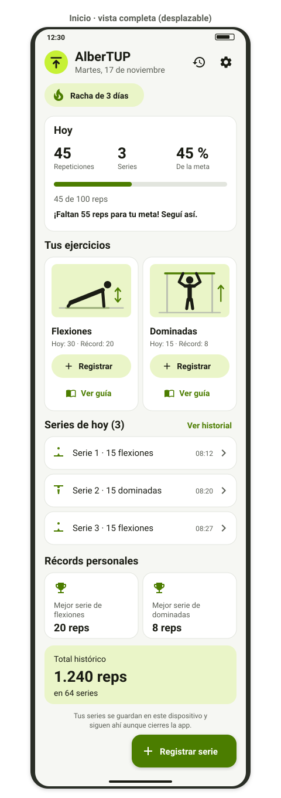

# AlberTUP

App Android para registrar series de **flexiones de brazos** y **dominadas**: meta diaria,
racha, récords personales, historial editable y guías de técnica con contenido de Wikipedia.
Proyecto del **Parcial 2** de Aplicaciones Móviles (Escuela Da Vinci).

## Documentación

- 📄 [Informe del parcial](docs/INFORME.md): propósito, mockups de cada pantalla, flujo de uso,
  checklist de requisitos, fuentes y escenario de demostración.
- 🔥 [Firebase](docs/FIREBASE.md): estado de la integración inicial y pasos para activarla.

## Videos de demostración

- [Recorrido por la app](docs/videos/albertup-walkthrough.mp4): registrar y editar una serie,
  consultar el historial y la guía, y cambiar idioma y tema.
- [Respaldo en Firebase](docs/videos/firebase-backup.mp4): respaldo manual de una serie con una
  cuenta temporal de prueba. El video muestra una sesión ya iniciada; no muestra el registro ni el
  inicio de sesión.

Los videos son capturas del emulador Android y no tienen audio.

## Funcionalidades

- 6 pantallas: Inicio, Registrar/editar serie, Historial, Guía de ejercicio, Ajustes y Cuenta.
- Datos persistentes en SQLite; totales, récords y racha calculados por día local.
- Editar y eliminar series con *Deshacer*; validación y confirmación de valores inusuales.
- Contenido en línea (Retrofit + Gson) y fotos (Glide) desde Wikipedia/Wikimedia Commons, con
  créditos y copia sin conexión.
- Español e inglés con selector de idioma dentro de la app; tema claro/oscuro; meta configurable.
- Firebase Auth + Firestore (opcional, requiere configuración).

## Compilar y ejecutar

1. Abrir la carpeta `albertup/` en Android Studio y sincronizar Gradle.
2. Ejecutar la configuración **app** en un dispositivo o emulador con Android 7.0 (API 24) o
   superior.
3. Pruebas unitarias: `cd albertup && ./gradlew testDebugUnitTest`.

Tecnologías: Java 11, layouts XML, Material Components 1.13, AndroidX, SQLite, Retrofit 3,
Glide 5, Firebase BoM 35.
