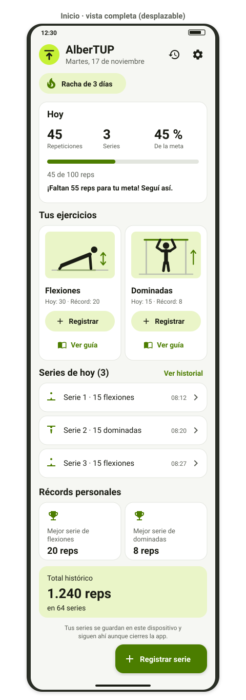
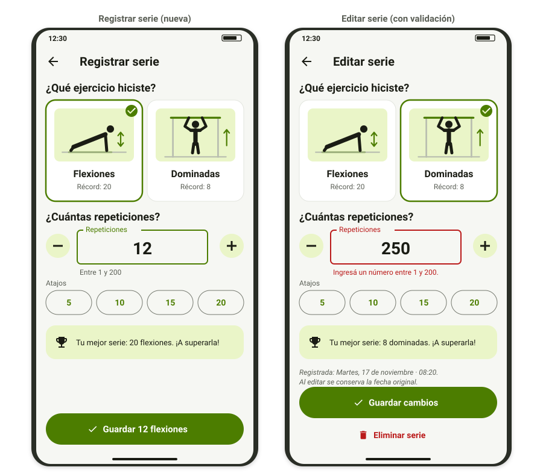
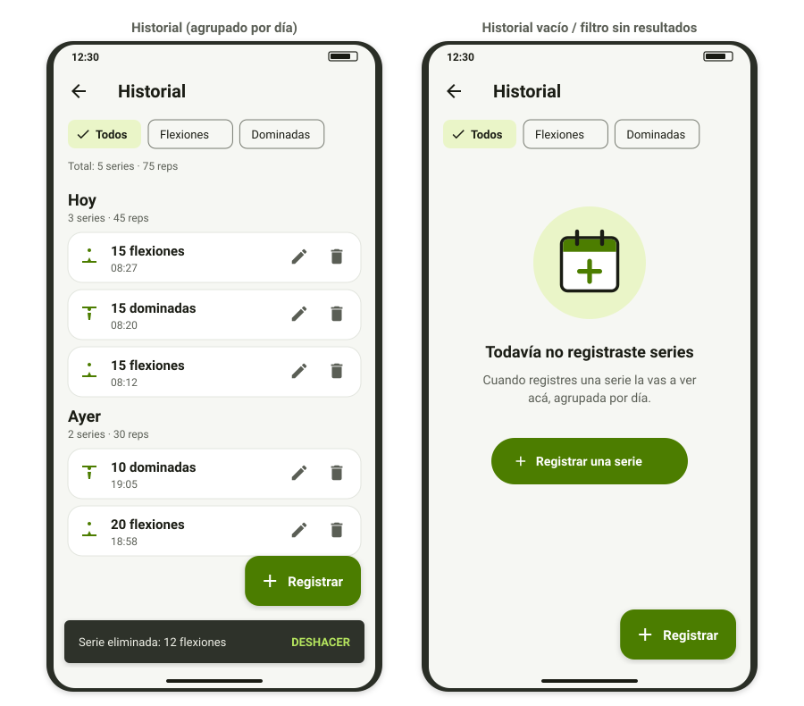
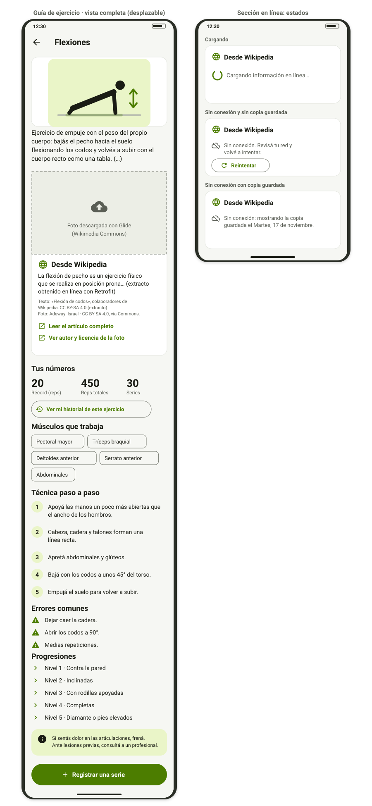
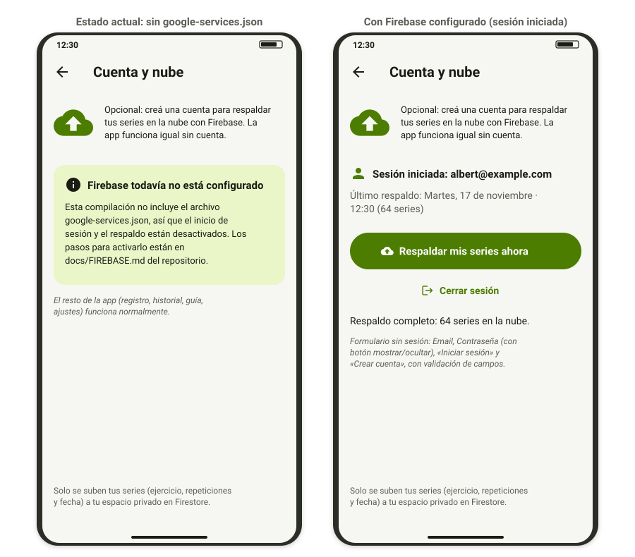
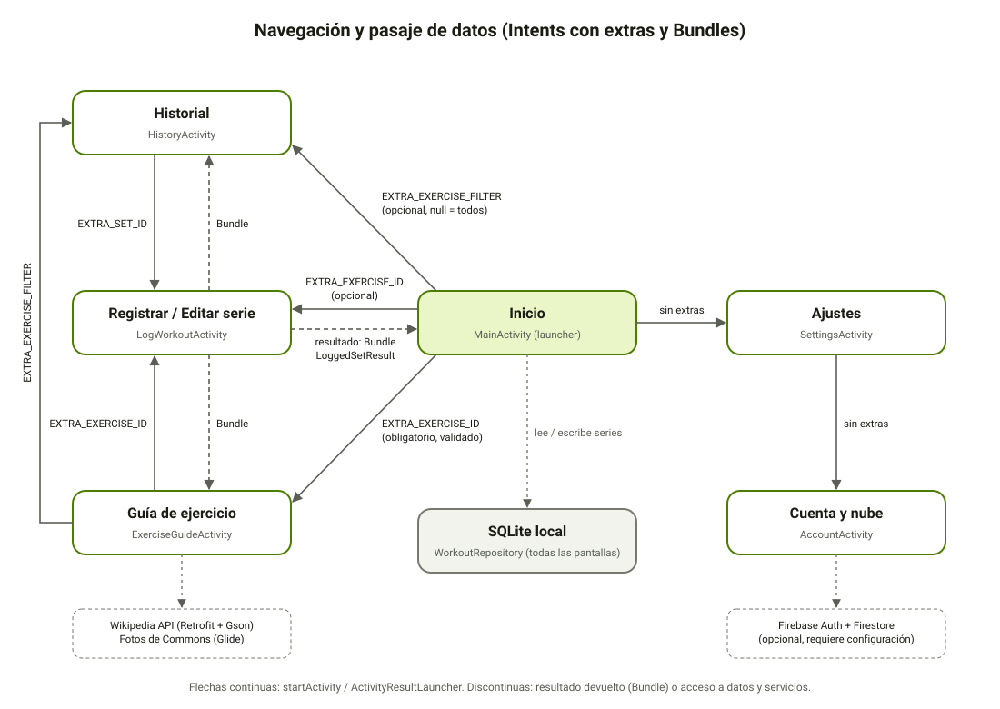

# Informe — AlberTUP

**Materia:** Aplicaciones Móviles — Prof. Sergio Medina

**Alumno:** Albert Lukmanov

**Trabajo:** Parcial 2, individual

## Idea de la aplicación

AlberTUP sirve para registrar series de flexiones y dominadas. La persona puede ver cuánto entrenó
en el día, comparar sus resultados con una meta y consultar una guía de cada ejercicio.

En comparación con la pre-entrega, se agregaron más pantallas, almacenamiento de las series,
historial, edición, guías con contenido de internet, ajustes y respaldo opcional en Firebase.

## Pantallas

Las imágenes son mockups; muestran ejemplos y no son capturas de la app en ejecución.

### Inicio

Muestra la fecha, la racha, el progreso de la meta, las series del día y los récords. Desde acá se
puede registrar una serie, abrir las guías, el historial o los ajustes.

### Registrar o editar una serie

Se elige flexiones o dominadas y se ingresa la cantidad de repeticiones. Se aceptan valores de 1 a
200 y se pide confirmación para cantidades inusuales. También se puede editar o eliminar una serie.

### Historial

Lista las series agrupadas por día. Permite filtrar por ejercicio, editar y eliminar con la opción
de deshacer.

### Guía de ejercicio

Muestra una descripción, técnica, errores comunes y progresiones. También carga un resumen de
Wikipedia y una imagen de Wikimedia Commons. Si no hay conexión, puede mostrar la última copia
guardada.

### Ajustes

Permite cambiar el idioma, el tema y la meta diaria. Desde esta pantalla también se abre la cuenta.

### Cuenta y nube

Permite crear una cuenta o iniciar sesión con correo y contraseña, y hacer un respaldo manual en
Firestore. Firebase es opcional: sin su archivo de configuración, la app sigue funcionando de
forma local. Los pasos de configuración están en [FIREBASE.md](FIREBASE.md).

## Navegación y datos

El recorrido principal es **Inicio → Registrar serie → Guardar → Inicio**. Al guardar se actualizan
las estadísticas. Desde Inicio o Historial se puede abrir una serie para editarla. La app envía el
ejercicio o el identificador de la serie entre pantallas mediante extras y devuelve el resultado al
guardar.

## Tecnologías

- Java y layouts XML, con componentes de Android y Material.
- SQLite para guardar las series y preferencias para el idioma, tema y meta.
- Retrofit y Gson para el contenido de Wikipedia; Glide para las imágenes.
- Firebase Authentication y Cloud Firestore para el respaldo opcional.

## Ejecución y pruebas

Abrir la carpeta `albertup/` en Android Studio, esperar la sincronización de Gradle y ejecutar
`app` en un dispositivo o emulador con Android 7.0 (API 24) o superior. Gradle usa JDK 17.

Se compiló la app y se probaron el registro y la edición de una serie, el historial, la guía, los
ajustes y el respaldo en un emulador. Los [videos](videos/) muestran esos recorridos. También se
ejecutaron pruebas unitarias y una prueba de respaldo a Firestore. Todavía faltan pruebas de errores
y de funcionamiento sin conexión para Firebase.

## Fuentes

- [Wikipedia: flexión de codos](https://es.wikipedia.org/wiki/Flexi%C3%B3n_de_codos) y
  [dominada](https://es.wikipedia.org/wiki/Dominada), y sus versiones en inglés:
  [push-up](https://en.wikipedia.org/wiki/Push-up) y [pull-up](https://en.wikipedia.org/wiki/Pull-up).
  Los resúmenes se atribuyen a Wikipedia y se comparten bajo CC BY-SA 4.0.
- [MediaWiki API](https://www.mediawiki.org/wiki/API:Main_page) para los resúmenes.
- [Push-up session.jpg](https://commons.wikimedia.org/wiki/File:Push-up_session.jpg), Adewuyi Israel,
  CC BY-SA 4.0; [Marine Pull-ups.jpg](https://commons.wikimedia.org/wiki/File:Marine_Pull-ups.jpg),
  Cpl. C.J. Yard, USMC, dominio público. La app muestra los créditos de las imágenes.
- [Material Icons](https://fonts.google.com/icons), Apache 2.0. Las ilustraciones de la app son propias.

## Para la entrega

La consigna indica equipos de dos integrantes; corresponde confirmar con el docente la entrega
individual. También hay que revisar la invitación de `sergiomedinaio` al repositorio y entregar el
enlace por Campus.
