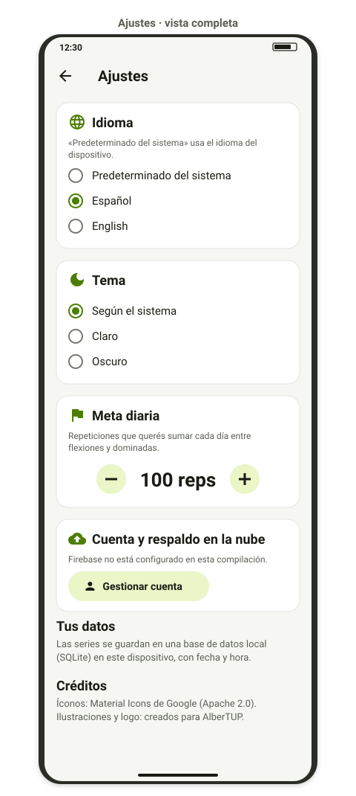

# Informe — Parcial 2: AlberTUP

| | |
|---|---|
| **Materia** | Aplicaciones Móviles — Prof. Sergio Medina |
| **Alumno** | Albert Lukmanov (trabajo **individual**; ver la nota de la sección 6) |
| **Repositorio** | <https://github.com/etonealbert/parcial-2-am-acn4av-lukmanov> |
| **App** | AlberTUP 1.0 — Android nativo (Java + layouts XML), minSdk 24, targetSdk 36 |

> **Sobre las imágenes de este informe:** son **mockups** (wireframes en SVG) generados a partir de
> los recursos reales de la app (mismos íconos, ilustraciones, colores y textos en español).
> **No son capturas de pantalla** de la app en ejecución. Los datos que se ven (45 reps, 3 series,
> etc.) son de ejemplo.

---

## 1. Propósito y usuario

**AlberTUP** ("Albert" + *push-**UP*** / *pull-**UP***) es un registro de entrenamiento de
calistenia enfocado en **flexiones de brazos** y **dominadas**.

- **Usuario objetivo:** personas que entrenan con su propio peso en casa, en una plaza o en el
  gimnasio (nivel principiante a intermedio) y quieren anotar cada serie en segundos, ver su
  progreso del día contra una meta, sostener una racha diaria y aprender la técnica correcta.
- **Problema que resuelve:** anotar series en papel o en notas no muestra totales, récords ni
  progreso. La app guarda cada serie con fecha y hora, calcula todo automáticamente y explica cómo
  hacer cada ejercicio y cómo progresar.

## 2. Cambios respecto a la pre-entrega

| Pre-entrega (Parcial 1) | Esta entrega |
|---|---|
| Una sola pantalla | **6 pantallas** con navegación entre ellas |
| Datos en memoria: se perdían al cerrar la app | **Base de datos SQLite**: las series sobreviven al cierre y reinicio |
| "Hoy" no dependía de la fecha | "Hoy" = rango del **día local** del dispositivo (con cambio de horario y medianoche) |
| Racha "3 días", fecha y total histórico **fijos** en el XML | Racha, fecha, totales y récords **calculados** de los datos guardados |
| Botones en el morado por defecto de Material 3; verde con contraste 4,2:1 | Paleta *volt* mapeada a los roles de Material 3, contraste ≥ 4,5:1 y **modo oscuro** completo |
| Solo inglés | **Bilingüe** (español por defecto + inglés) con **selector de idioma dentro de la app** |
| Sin contenido externo | Resumen de **Wikipedia** y foto de **Wikimedia Commons** descargados de internet |
| Sin edición ni borrado | Editar y eliminar series con **deshacer** |

## 3. Pantallas

Todas las pantallas tienen como raíz un **ConstraintLayout** y combinan **LinearLayout vertical
y horizontal**, **Button** y **TextView**. Todas respetan las barras del sistema (*edge-to-edge*),
se desplazan si el contenido no entra y limitan el ancho del contenido en tablets/horizontal.

### 3.1 Inicio (`MainActivity`)

- **Propósito:** resumen del día y punto de partida hacia todas las funciones.
- **Funcionalidad esperada:**
  - Fecha actual y **racha** de días consecutivos con al menos una serie.
  - Tarjeta **Hoy**: repeticiones, series, porcentaje y barra de progreso hacia la **meta diaria**,
    y un mensaje motivacional que cambia según el avance ("Faltan 55 reps…", "¡Meta cumplida!").
  - Tarjetas por ejercicio con lo hecho hoy y el récord, y botones **Registrar** y **Ver guía**.
  - **Series de hoy**: una tarjeta por serie (número, ejercicio, repeticiones y hora), generada
    dinámicamente dentro del `ScrollView`; estado vacío con ilustración cuando no hay series.
  - **Récords personales** por ejercicio y **total histórico** (repeticiones y series).
- **Interacciones:** botón flotante **Registrar serie** siempre visible; tocar una serie abre la
  edición; íconos de **Historial** y **Ajustes** en el encabezado; al volver de registrar aparece
  un *Snackbar* de confirmación con **Deshacer** (o "¡Nuevo récord personal!").
- **Navegación y datos:** abre *Registrar* (con o sin ejercicio preseleccionado), *Historial*,
  *Guía* (con el id del ejercicio) y *Ajustes*. Recalcula todo al volver a la pantalla, a la
  medianoche local y si cambia la fecha, la hora o la zona horaria.

### 3.2 Registrar / editar serie (`LogWorkoutActivity`)

- **Propósito:** cargar una serie en pocos toques, o corregir/eliminar una existente.
- **Funcionalidad esperada:**
  - Elección del ejercicio con **tarjetas seleccionables**: la elegida muestra un **ícono de
    check y un borde más grueso** (no depende solo del color).
  - Repeticiones con **campo numérico**, botones **−/+** y **atajos** (5, 10, 15, 20).
  - **Validación**: vacío o fuera de 1–200 muestra un error en el campo. Valores válidos pero
    inusuales (más de 100 flexiones o 40 dominadas en una serie) piden **confirmación** para
    evitar errores de tipeo (150 en vez de 15).
  - Indica el récord actual y avisa en vivo si la serie lo supera.
  - **Modo edición** (cuando llega un id de serie): título "Editar serie", conserva la fecha
    original, botón **Eliminar serie** con confirmación, y si se intenta salir con cambios sin
    guardar pregunta si se descartan.
- **Navegación y datos:** recibe `EXTRA_EXERCISE_ID` (opcional) o `EXTRA_SET_ID` (edición). Si el
  id de serie no existe, se cierra con un aviso; si el ejercicio es desconocido, usa el valor por
  defecto. Devuelve el resultado como un **Bundle** (`LoggedSetResult`) con la acción (creada,
  editada o eliminada), la serie completa y si fue récord. Con el teclado abierto, el botón
  Guardar queda visible sobre el teclado.

### 3.3 Historial (`HistoryActivity`)

- **Propósito:** ver y administrar todas las series registradas.
- **Funcionalidad esperada:** lista (`RecyclerView`) **agrupada por día** con encabezados "Hoy",
  "Ayer" o la fecha completa y el total de cada día; total general según el filtro; **chips de
  filtro** (Todos / Flexiones / Dominadas) con check visible; estados vacíos distintos para "sin
  datos" y "filtro sin resultados", con un botón para registrar.
- **Interacciones:** editar (tocar la fila o el lápiz) y **eliminar con Deshacer**; el botón
  flotante se achica al desplazarse y registra una serie del ejercicio filtrado.
- **Navegación y datos:** recibe `EXTRA_EXERCISE_FILTER` (opcional, validado). Abre la edición
  con `EXTRA_SET_ID` y procesa el Bundle de resultado para mostrar la confirmación.

### 3.4 Guía de ejercicio (`ExerciseGuideActivity`)

- **Propósito:** aprender a hacer el ejercicio y ver los números propios.
- **Funcionalidad esperada:**
  - Ilustración, descripción, **músculos que trabaja**, **técnica paso a paso**, **errores
    comunes**, **progresiones** por nivel y nota de seguridad (contenido propio, en ambos idiomas).
  - **Desde Wikipedia:** resumen del artículo en el idioma de la app, obtenido con **Retrofit**, y
    una **foto de Wikimedia Commons descargada con Glide**, con créditos de texto (CC BY-SA 4.0) y
    de la foto (autor y licencia) y enlaces al artículo y a la página de la licencia.
  - Estados: **cargando**, **contenido**, **vacío**, **error con Reintentar** y **sin conexión con
    copia guardada** (se muestra la última respuesta buscada).
  - **Tus números:** récord, repeticiones totales y cantidad de series de ese ejercicio.
- **Navegación y datos:** requiere `EXTRA_EXERCISE_ID`; si falta o es inválido se cierra con un
  aviso. Abre *Registrar* con el ejercicio preseleccionado y *Historial* filtrado por ejercicio.

### 3.5 Ajustes (`SettingsActivity`)

- **Propósito:** personalizar la app.
- **Funcionalidad esperada:**
  - **Idioma de la app** independiente del dispositivo: predeterminado del sistema, Español o
    English (API de idiomas por app de AppCompat; se recuerda al reiniciar). En Android 13+ también
    aparece en los ajustes del sistema.
  - **Tema:** según el sistema, claro u oscuro (se guarda y se aplica al iniciar).
  - **Meta diaria** de 10 a 1000 repeticiones, de a 10, que usa la pantalla de inicio.
  - Estado de la **cuenta en la nube** y acceso a *Cuenta y nube*; explicación de dónde se guardan
    los datos y créditos.

### 3.6 Cuenta y nube (`AccountActivity`, Firebase — implementación inicial)

- **Propósito:** cuenta opcional para respaldar las series en la nube.
- **Funcionalidad esperada:** crear cuenta, iniciar y cerrar sesión con email y contraseña
  (Firebase Auth) con validaciones y mensajes de error claros; **respaldo manual** de todas las
  series en Cloud Firestore.
- **Estado actual:** el repositorio **no incluye** `google-services.json`, por lo que la pantalla
  muestra "Firebase todavía no está configurado" y el resto de la app funciona normalmente. La
  configuración y lo pendiente están en [FIREBASE.md](FIREBASE.md).

## 4. Flujo de uso y pasaje de datos

Flujo típico: **Inicio → Registrar serie → Guardar → vuelve a Inicio** con un Snackbar y los
totales, la meta, la racha y la lista de hoy actualizados. Desde la lista o el **Historial** se
corrige o elimina una serie (con Deshacer). La **Guía** enseña la técnica y permite registrar ese
ejercicio directamente. En **Ajustes** se cambia idioma, tema y meta.

| Origen → destino | Dato enviado | Tipo | Validación en el destino |
|---|---|---|---|
| Inicio / Historial / Guía → Registrar | `EXTRA_EXERCISE_ID` | `String` (id estable: `push_up`, `pull_up`) | Id desconocido → ejercicio por defecto |
| Inicio / Historial → Editar | `EXTRA_SET_ID` | `long` | Ausente, ≤ 0 o inexistente → aviso y cierre |
| Registrar/Editar → pantalla que lo abrió | `LoggedSetResult.EXTRA_RESULT` | **Bundle** con 8 claves (acción, id, uuid, ejercicio, reps, fechas, récord) | Bundle incompleto o inválido → se ignora |
| Inicio → Guía | `EXTRA_EXERCISE_ID` | `String` (obligatorio) | Ausente o inválido → aviso y cierre |
| Inicio / Guía → Historial | `EXTRA_EXERCISE_FILTER` | `String` (opcional) | Desconocido → "Todos" |

Los resultados se reciben con `ActivityResultLauncher` (API actual que reemplaza a
`startActivityForResult`). La flecha "atrás" de cada pantalla usa el mismo flujo que el botón
"Atrás" del sistema.

## 5. Decisiones técnicas

- **Organización del código** (`albertup/app/src/main/java/com/example/albertup`):
  `data` (SQLite, preferencias, modelos), `domain` (cálculos puros testeables), `network`
  (Wikipedia), `cloud` (Firebase), `ui` (adaptadores, formateo, contrato de resultados) y las
  Activities.
- **Persistencia:** `SQLiteOpenHelper` sin dependencias extra. Cada serie guarda un **id estable
  del ejercicio** (no el texto traducido), las repeticiones, la **fecha/hora en milisegundos** y un
  UUID. Totales, récords y racha **se derivan de los datos** en cada consulta, así que editar o
  borrar nunca deja valores viejos.
- **Fechas:** "hoy" se calcula con el día local del dispositivo (`Calendar`, compatible con API 24),
  contemplando días de 23/25 horas por cambio de horario. Hay pruebas unitarias para estos casos.
- **Red:** Retrofit + Gson para la API de MediaWiki y Glide para las fotos. Wikimedia rechaza
  clientes genéricos, por eso cada pedido envía un `User-Agent` identificatorio. Solo se abren
  enlaces `https` de Wikipedia/Wikimedia recibidos de la API.
- **Idiomas:** `values/` (español) y `values-en/` (inglés), con *plurals* ("1 serie" / "3 series")
  y números con el formato de cada idioma ("1.240" / "1,240").
- **Accesibilidad:** contraste ≥ 4,5:1 en texto, objetivos táctiles de 48 dp, descripciones para
  íconos, encabezados marcados para lectores de pantalla, regiones "en vivo" para mensajes,
  selección indicada con forma además de color, textos en `sp` y alturas flexibles para fuentes
  grandes.
- **Recursos organizados:** `strings.xml`, `plurals.xml` y `guide_content.xml` (en ambos idiomas),
  `dimens.xml`, `colors.xml` (claro y oscuro), `styles.xml` y `themes.xml`.

## 6. Checklist de requisitos del PDF

**Leyenda:** ✅ implementado · ⚠️ con observaciones · ⏳ acción pendiente de entrega

### Consignas de entrega

| Requisito | Estado | Detalle |
|---|---|---|
| Equipos de 2 integrantes | ⚠️ | **El trabajo es individual.** El PDF pide equipos de 2: hay que confirmar con el docente que se acepta la entrega individual. |
| Nombre del repositorio con el formato pedido | ⚠️ | `parcial-2-am-acn4av-lukmanov`: tiene un solo apellido (coherente con trabajo individual). Si se exigiera equipo, el formato requiere ambos apellidos en orden alfabético. Verificar también que `acn4av` sea el código exacto de la comisión. |
| Agregar al usuario `sergiomedinaio` al repositorio | ⏳ | Acción manual en GitHub (Settings → Collaborators); no se puede verificar desde el código. |
| Entrega por Campus con el enlace | ⏳ | A cargo del alumno. |

### Desarrollo mínimo (nota 4)

| Requisito | Estado | Evidencia |
|---|---|---|
| Varias pantallas con navegación | ✅ | 6 Activities (sección 3) y diagrama de la sección 4. |
| Informe por pantalla con funcionalidades y flujo | ✅ | Secciones 3 y 4 de este documento. |
| Mock de cada pantalla (herramienta libre) | ✅ | `docs/mockups/*.svg`, uno por pantalla más el diagrama de flujo. |
| ConstraintLayout | ✅ | Raíz de las 6 pantallas (`activity_*.xml`). |
| LinearLayout vertical / horizontal | ✅ | Ej.: `activity_main.xml` (`columnMain` vertical; `headerRow`, `statsRow`, `exerciseCardsRow`, `prRow` horizontales). |
| Button | ✅ | Ej.: `btnSave`, `btnLogPushUp`, `btnRetry`, `btnGoalPlus`, `btnSignIn`. |
| TextView | ✅ | En todas las pantallas. |
| Contenido real acompañado de imágenes | ✅ | Guías de técnica reales en ES/EN, ilustraciones propias por ejercicio y fotos de Wikimedia Commons con créditos. |
| Al menos un elemento con evento | ✅ | Clicks, `TextWatcher`, acción del teclado, chips de filtro, radios, botón atrás, resultados entre pantallas. |
| Comportamiento dinámico (agregar varios ítems y verlos) | ✅ | Cada serie registrada se agrega como tarjeta en "Series de hoy" (dentro del `ScrollView`) y en el historial; totales, meta, racha y récords cambian. |
| Cambios aplicados al repositorio en varios commits | ✅ | Commits locales con *Conventional Commits* (sección 11). ⏳ Falta hacer `push`. |
| Cambios de ambos integrantes visibles en GitHub | ⚠️ | No aplica a un trabajo individual; depende de la aceptación del docente. |

### Agregados para llegar a 10

| Agregado | Estado | Detalle |
|---|---|---|
| Colores / diseño y ajustes respecto a la pre-entrega | ✅ | Sección 2: paleta accesible, modo oscuro, ícono de la app, estados vacíos y de error. |
| Strings, dimensiones y colores organizados | ✅ | Sin textos ni medidas fijas en layouts o código (salvo símbolos no traducibles marcados). |
| Más interacciones / comportamientos | ✅ | Registrar, editar, eliminar, deshacer, filtrar, validar, confirmar, reintentar, idioma, tema, meta, respaldo. |
| Convención de commits | ✅ | *Conventional Commits* (`feat`, `style`, `docs`…). |
| Pasaje de datos entre activities | ✅ | Tabla de la sección 4. |
| Uso de extras para el envío de paquetes | ✅ | `LoggedSetResult` arma un **Bundle** y lo envía como extra en el resultado; el receptor lo valida. |
| Descarga de imágenes desde URL | ✅* | Glide descarga la foto de Commons con *placeholder*, error y caché. |
| Contenido desde URL con una biblioteca | ✅* | Retrofit + Gson con la API de MediaWiki, con estados de carga, vacío, error y sin conexión. |
| Firebase Auth y/o Firestore | ⚠️ | Implementación **inicial** (registro, login, respaldo). Requiere crear el proyecto y agregar `google-services.json`; ver [FIREBASE.md](FIREBASE.md). |

\* Implementado y revisado estáticamente; **pendiente de verificar en un dispositivo** con internet.

## 7. Fuentes de contenido e imágenes

| Recurso | Autor / origen | Licencia |
|---|---|---|
| Textos de técnica, músculos, errores y progresiones | Redactados para AlberTUP a partir de conocimiento general de entrenamiento (no reemplazan consejo médico) | Propios |
| Ilustraciones de los ejercicios, estado vacío, logo e ícono de la app | Vectores creados para AlberTUP | Propios |
| Íconos de interfaz | [Material Icons](https://fonts.google.com/icons) de Google | Apache 2.0 |
| Resúmenes en línea | Wikipedia: [Flexión de codos](https://es.wikipedia.org/wiki/Flexi%C3%B3n_de_codos), [Dominada](https://es.wikipedia.org/wiki/Dominada), [Push-up](https://en.wikipedia.org/wiki/Push-up), [Pull-up](https://en.wikipedia.org/wiki/Pull-up) | CC BY-SA 4.0 (se muestra un extracto con crédito y enlace) |
| Foto de flexiones | [Push-up session.jpg](https://commons.wikimedia.org/wiki/File:Push-up_session.jpg) — Adewuyi Israel | CC BY-SA 4.0 |
| Foto de dominadas | [Marine Pull-ups.jpg](https://commons.wikimedia.org/wiki/File:Marine_Pull-ups.jpg) — Cpl. C.J. Yard, USMC | Dominio público (obra del gobierno de EE. UU.) |
| API de contenido | [API de MediaWiki](https://www.mediawiki.org/wiki/API:Main_page) — [política de acceso](https://www.mediawiki.org/wiki/Wikimedia_APIs/Access_policy) y [límites](https://www.mediawiki.org/wiki/Wikimedia_APIs/Rate_limits) | Uso libre con `User-Agent` identificatorio; la app hace 1 pedido por apertura de guía |

La app muestra los créditos del autor y la licencia de cada foto tal como los informa la API
(campos `Artist` y `LicenseShortName` de Commons) y enlaza a la página de la licencia.

## 8. Cómo compilar y ejecutar

1. Clonar el repositorio y abrir la carpeta **`albertup/`** en Android Studio (versión con soporte
   para AGP 8.13; Gradle se ejecuta con el JDK 17 incluido).
2. Esperar la sincronización de Gradle (descarga las dependencias declaradas).
3. Ejecutar la configuración **app** en un emulador o dispositivo con **Android 7.0 (API 24)** o
   superior.
4. Desde la terminal: `cd albertup && ./gradlew assembleDebug` y, para las pruebas unitarias,
   `./gradlew testDebugUnitTest`.

- **Red:** solo la sección "Desde Wikipedia" de la guía necesita internet. Todo lo demás funciona
  sin conexión.
- **Firebase:** opcional. Sin `google-services.json` la app compila y funciona; para activarlo ver
  [FIREBASE.md](FIREBASE.md).

## 9. Escenario de demostración (5 minutos)

1. Abrir la app sin datos: Inicio muestra "Empezá tu racha hoy", 0 repeticiones y el estado vacío.
2. **Registrar serie** → Flexiones → atajo **15** → Guardar. Vuelve a Inicio con "¡Nuevo récord
   personal! 15 flexiones" (con Deshacer); aparecen 15 reps, 1 serie, 15 %, racha de 1 día y la
   tarjeta "Serie 1".
3. En la tarjeta Dominadas tocar **Registrar** (llega preseleccionado). Escribir **250** → error de
   validación; escribir **60** → diálogo de confirmación → **Corregir**; poner **8** y guardar.
4. Tocar "Serie 1" en *Series de hoy* → cambiar a 18 → **Guardar cambios** → los totales se
   actualizan.
5. **Historial** → filtrar por Dominadas → eliminar una serie → **Deshacer**.
6. **Ver guía** de Flexiones → recorrer técnica y progresiones; ver el resumen y la foto de
   Wikipedia; tocar **Leer el artículo completo**. Activar el modo avión y volver a abrir la guía:
   se muestra la copia guardada; en una guía nunca abierta aparece el error con **Reintentar**.
7. **Ajustes** → **English** (toda la app cambia de idioma) → **Oscuro** → meta **150**: el
   porcentaje de Inicio cambia.
8. Cerrar la app desde recientes y volver a abrirla: las series siguen ahí. Rotar la pantalla en
   *Registrar serie*: el ejercicio y las repeticiones se mantienen.
9. **Ajustes → Gestionar cuenta**: indica que Firebase no está configurado y dónde ver los pasos.

## 10. Estado de verificación y limitaciones conocidas

- **No se compiló, no se ejecutaron las pruebas y no se corrió la app** en la máquina donde se
  escribió este trabajo: el código, los recursos y las dependencias se revisaron de forma
  estática. Antes de entregar hay que compilar, correr `testDebugUnitTest` y recorrer el
  escenario de la sección 9 en un emulador.
- Las versiones de las bibliotecas se eligieron compatibles con AGP 8.13.2 y compileSdk 36 (por
  ejemplo, Glide 5.0.7 porque 5.0.9 exige compileSdk 37), pero la resolución completa de
  dependencias no se probó.
- Las consultas a SQLite son chicas e indexadas y se hacen en el hilo principal; para volúmenes
  grandes convendría moverlas a un hilo de fondo.
- El ícono nuevo es adaptativo (Android 8+); en Android 7.x se sigue viendo el ícono anterior.
- Firebase es una implementación inicial sin verificar (detalle en [FIREBASE.md](FIREBASE.md)).

## 11. Historial de commits

Los commits siguen *Conventional Commits* y se pueden ver con `git log --oneline`. Cada uno agrega
una parte funcional y coherente: tema y recursos, idiomas, persistencia, pantalla de registro,
historial, guía, inicio, ajustes, contenido en línea, Firebase y documentación.
